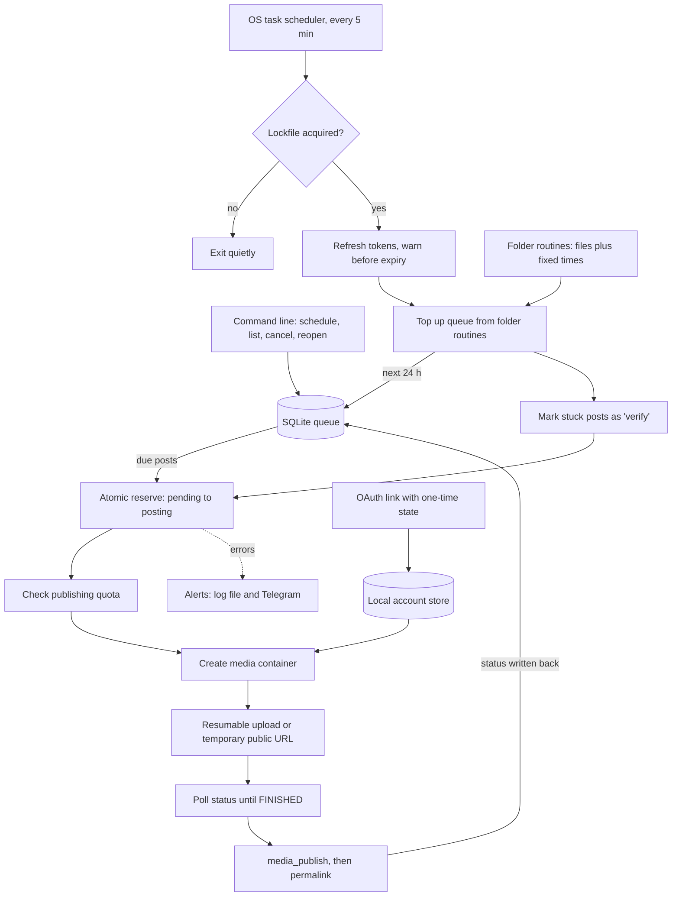

# Instagram Scheduler on the Meta Graph API

A multi-account scheduler that publishes Reels, photos, carousels and Stories through Meta's official Content Publishing API.

Case study · Python · SQLite · Meta Graph API · OAuth 2.0 · pytest

## The problem

Scheduled posting to several Instagram accounts has three hard requirements. It must use only documented Meta endpoints, so the accounts stay safe. It must run unattended on a desktop machine. And a crash mid-post must never publish the same post twice.

## Architecture

## Engineering decisions

- **Crash recovery prefers "verify" to retry.** A post stuck in "posting" for over an hour moves to "verify" and never re-enters the queue by itself. The process may have died after Meta published, so a retry could duplicate it.
- **Two layers against double execution.** Reservation is one conditional UPDATE that only succeeds while the row is pending. An OS-level file lock blocks a second run, and the scheduled task ignores new instances.
- **Errors are classified before any retry.** Network failures, 5xx responses and known rate-limit codes retry after 15 minutes, up to 3 attempts. A full publishing quota postpones the post by one hour without spending an attempt. Unexpected exceptions fail the post and ask for a manual check.
- **Video skips public hosting where Meta allows it.** In the Facebook Login flow, video goes to Meta's resumable upload host. Images, and video in the Instagram Login flow, need a public URL. For those, a local HTTP server and a temporary Cloudflare quick tunnel serve randomly named files, with directory listing off, and close after the post.
- **Credentials stay out of error messages.** POST requests carry the token in the body instead of the URL, and every error message masks the token and app secret. The account file is written atomically. Onboarding another person's account uses an OAuth link with a random one-time state that expires after 24 hours.

## How it stays up

- A hidden Windows scheduled task runs the queue every 5 minutes, with a 30-minute execution limit.
- Instagram Login tokens renew when fewer than 15 days remain. Tokens that cannot renew trigger an alert within 7 days of expiry.
- Container processing times out after 900 seconds, polled every 20. HTTP calls time out after 120 seconds.
- Folder routines queue each file once and alert once a day when a folder runs dry.
- Validation runs before any API call: JPEG only, 2,200-character captions, 30 hashtags, 2 to 20 carousel items, size caps per media type.

## How it is tested

257 pytest tests (224 functions, some parametrized) pass in about 5 seconds. HTTP goes through a fake session that records every call, and clocks are injected. Tests cover each post type end to end, token masking, the lock, single reservation, stuck posts, quota postponement, retry versus permanent failure, routine idempotence and OAuth state reuse.

## Status

In development. Per the tests, the four post types, the queue, folder routines, token refresh, OAuth onboarding, resumable upload and temporary hosting work.

## Known limits

- It runs on one Windows desktop and only while the user is logged in.
- Tunnel hosting depends on the cloudflared binary and a working network.
- Expiring Facebook Login tokens cannot renew automatically. The tool only alerts.
- Collaborator tags work only in the Facebook Login flow, up to 3.
- Tests use simulated HTTP. Nothing runs against the live API automatically.
- There is no web interface yet.

## Stack

| Layer | Choice |
|---|---|
| Language | Python 3.12 |
| HTTP | requests |
| Storage | SQLite queue, JSON account store |
| API | Instagram Graph API v27 Content Publishing |
| Auth | OAuth 2.0, Facebook Login and Instagram Login |
| Media hosting | Local HTTP server, Cloudflare quick tunnel |
| Scheduling | Windows Task Scheduler, PowerShell |
| Alerts | Telegram Bot API |
| Tests | pytest |

Solo project, built with AI-assisted development (Claude Code).

Source code is private. Happy to walk through it in a call.
